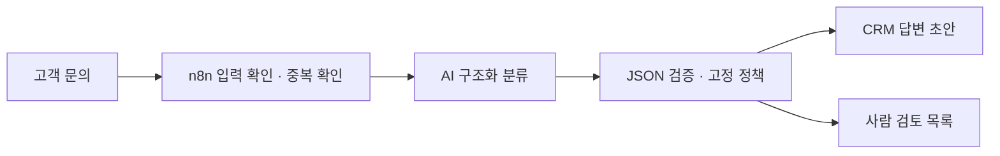

# AI 고객 문의 분류와 n8n 업무 자동화

고객 문의를 AI가 분류하고, 고정된 규칙이 **CRM 답변 초안** 또는 **사람 검토**로 보냅니다. JSON 형식 오류, 낮은 신뢰도, 모델이 표시한 고위험 분류는 사람 검토로 보냅니다. 저장 실패와 처리 결과 불명은 호출자에게 별도 상태로 반환합니다. 고객에게 답변을 자동 발송하지 않습니다.

고객 지원팀의 반복 분류와 답변 초안 준비를 위한 합성 포트폴리오 예제이며 실제 고객 의뢰 작업은 아닙니다. 입력은 문의 번호·이메일·제목·본문이고 출력은 저장된 초안 또는 사람 검토 항목입니다.

실제 n8n이 요청을 조정합니다. CRM과 검토 목록은 SQLite 기반 로컬 모의 API이며 모든 예시는 합성 데이터입니다. AI는 분류기이고 최종 경로는 JavaScript 정책이 결정합니다. 프로젝트 개발에도 AI 도구를 사용했습니다.

기본 실행은 고정 응답의 가짜 AI로 오류 경로를 재현합니다. 이미 설치된 Ollama 모델로 연결하는 설정도 제공합니다.

## 분류와 처리 규칙

| 조건 | 결과 |
| --- | --- |
| 모델 분류가 `order_status` / `technical`, 신뢰도 ≥ 0.85, 검토 요청 없음 | CRM 초안 기록 |
| 모델 분류가 `refund` / `account_access` | 사람 검토 |
| 그 외 분류, 낮은 신뢰도, 모델의 검토 요청 | 사람 검토 |
| AI 출력 형식 오류, AI 서비스 오류 | 사유를 기록하고 사람 검토 |
| 상태 저장 실패, 응답 계약 오류 | HTTP 503 및 결과 불명 상태 |

**JSON 형식이 맞는다고 의미가 맞는 것은 아닙니다.** 모델이 환불 문의를 주문 조회로 잘못 분류하면 정책도 그 분류를 사용합니다. 의미상 모든 고위험 문의의 식별이나 프롬프트 주입 방어를 보장하지 않습니다.

## 같은 문의가 다시 들어오면

같은 `ticket_id`와 정규화된 내용은 중복입니다. 응답에 저장된 `status`, `attempt_id`, `record_id`, `needs_attention`을 포함합니다. 완료된 중복은 HTTP 200, `RECEIVED` / `AI_CLASSIFIED` / `AI_FAILED`인 중복은 HTTP 202로 미완료를 표시합니다. 202는 완료 응답이 아닙니다. 상태 API를 확인한 뒤 원인을 조사해야 하며 자동 재실행하지 않습니다. 같은 번호에 다른 내용을 보내면 HTTP 409입니다.

사업 기록의 응답이 유실되면 실제 기록이 있는지 확인합니다. 확인된 기록은 완료, 기록 없음은 `WRITE_FAILED`(HTTP 502), 확인도 실패하면 `WRITE_UNRESOLVED`(HTTP 503)입니다. `WRITE_FAILED`만 동일 내용으로 재시도할 수 있고, 이전 시도의 늦은 쓰기는 시도 번호로 차단합니다.

## 실행과 자료

- [로컬 실행 방법과 응답 계약](docs/RUN_LOCAL.md)
- [설계 설명](docs/CASE_STUDY.md)
- [실제로 실행한 검증과 의존성 검토](docs/VALIDATION.md)
- [n8n 워크플로](workflows/support-triage.json), [정책 코드](workflow_code/policy.js)

이 저장소는 localhost 데모입니다. 실제 CRM 연동, 운영 인증, 공개 서버 배포는 포함하지 않습니다. 설치된 의존성에는 남아 있는 보안 권고가 있으므로 공개 네트워크에 서비스로 노출하지 마세요.
